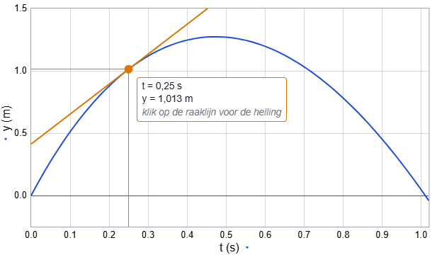
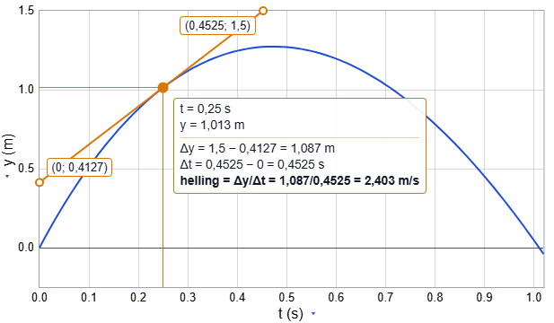

Didactiek van de Modelleertaal webapp
=====================================

Waarom de webapp werkt zoals hij werkt. Dit document beschrijft de uitgangspunten, het didactische doel
en per onderdeel de overweging erachter. Het is bedoeld voor docenten die de webapp in hun les gebruiken
en voor iedereen die aan de webapp bouwt: past een nieuwe functie niet bij deze uitgangspunten, dan
hoort hij er niet in (of moet dit document eerst veranderen).

De bediening per knop staat in de [README](README.md#webapp); wat er per versie veranderd is in de
[CHANGELOG](CHANGELOG.md).

## Didactisch doel

Een leerling in de bovenbouw (havo/vwo) moet met *natuurkundig modelleren*:

1. **begrijpen hoe een numeriek model rekent:** stap voor stap, in een rekenlus met een tijdstap `dt`;
2. **modelregels kunnen lezen, aanvullen en aanpassen,** zoals in het centraal examen (vaak met puntjes
   `...` die ingevuld moeten worden);
3. **grafieken interpreteren:** aflezen, de helling bepalen en varianten van een model vergelijken.

De webapp is gereedschap voor die drie vaardigheden. Het is geen simulatie om naar te kijken, maar een
plek om modellen te maken, door te rekenen en te onderzoeken.

## Uitgangspunten

### Geen knoppencursus

Een leerling uit 5 vwo moet zonder uitleg kunnen werken. Liever een knop weghalen dan een knop toevoegen.
De aanleiding voor deze webapp was precies dit: in de software op school was het al moeilijk om een
grafiek te maken, laat staan voor leerlingen.

Daarom staan functies **op de plek waar je kijkt**, niet in een menu:

- een punt aflezen doe je door in de grafiek te klikken;
- de grootheid op een as kies je op het aslabel zelf;
- inzoomen doe je door een rechthoek in de grafiek te slepen;
- een stroom toevoegen doe je met een **+** naast de toestandsvariabele in het diagram.

### Uitlegtekst op het scherm is een signaal dat de bediening niet klopt

Staat er een zin als "klik hier om ...", dan is de bediening niet vanzelfsprekend. Vervang zo'n zin door
een zichtbare aanwijzing: een cursor (een kruisje boven de grafiek), een rand bij hover, een knop bij het
geselecteerde ding, een klein pijltje naast een aslabel.

### De tekst van het model is de bron

Examens gebruiken tekstmodellen. Het grafische model (stock-flow diagram) is een **tweede kijk op dezelfde
tekst**: het wordt getekend uit de tekst, en elke wijziging in het diagram is een kleine wijziging in de
tekst. Pijlen in het diagram volgen uit de formules en kunnen niet los getekend worden; zo kunnen tekst
en diagram elkaar nooit tegenspreken.

Ook informatie die bij het model hoort, staat in de tekst. Een eenheid schrijf je als commentaar achter
de startwaarde (`v = 0 '[m/s]`), zoals je dat op papier ook zou doen. Het veld *Eenheid* in de formulieren
van het diagram schrijft precies dat commentaar.

### Run is een bewust moment

De webapp rekent niet opnieuw bij elke toetsaanslag. De **Run**-knop maakt zichtbaar wanneer het model
wordt doorgerekend, en na een wijziging worden de oude resultaten grijs tot je opnieuw op Run drukt. Zo
blijft het verband tussen "ik verander het model" en "ik zie het effect" een handeling van de leerling.

### Hulp is informatie, geen blokkade

Meldingen helpen, maar houden de leerling niet tegen. Een fout in het model geeft één melding, met de
regel gemarkeerd en een suggestie (*Bedoel je 'Fres'?*). Tips na Run zijn informatie, er staat er
hoogstens één tegelijk, en ze verschijnen alleen als er geen belangrijkere melding is.

## Per onderdeel

### De rekenlus zichtbaar maken: Stap

Regel voor regel door het model lopen is het beste middel om de rekenlus te begrijpen. Bij **Stap** licht
de regel op in de editor en staat de berekening **met ingevulde getallen** onder de runbalk:

```
iteratie 3, regel 6:  v = v + a*dt  →  v = 0,981 + 9,78 × 0,1 = 1,959
```

Bij `als ... dan` zie je de voorwaarde en of hij waar is. In de tabel licht de cel op die net veranderde,
en in de grafiek groeien de punten mee over de grijze lijn van de laatste Run. Zo zie je dat de grafiek
niets anders is dan de tabel, en de tabel niets anders dan de rekenlus, iteratie na iteratie.

### De tijdstap dt

Dat de uitkomst van een numeriek model afhangt van `dt` is examenstof. De webapp maakt dat op drie
manieren zichtbaar, zonder instelling:

- naast het aantal iteraties staat hoe lang het model loopt: `× dt = 50 s`. Het verband
  *N × dt = eindtijd* is een leerdoel; leerlingen denken in tijd ("ik wil 20 s zien"), niet in iteraties;
- na Run rekent de webapp het model op de achtergrond nog eens door met de halve tijdstap. Hangt de
  uitkomst daarvan af, dan meldt hij dat `dt` te groot is, met de twee uitkomsten erbij;
- wordt een waarde ongeldig omdat de getallen steeds groter worden, dan noemt de melding `dt` als
  waarschijnlijke oorzaak.

### Varianten vergelijken: de grijze lijn

Systematisch één grootheid variëren is een kernvaardigheid bij modelleren. De vorige run blijft als
grijze lijn in de grafiek staan, en onder de grafiek staat **wat** er anders is (`k = 0,37 → nu 0,50`).
De leerling hoeft niet te onthouden wat hij veranderde. Met **Houd vast** blijft één run staan als
referentie, zodat je meerdere varianten met dezelfde basis kunt vergelijken.

Er zijn bewust geen schuifregelaars: een startwaarde in de tekst veranderen en opnieuw op Run drukken is
de handeling die het examen vraagt.

### Grafieken lezen: aflezen en helling

Een klik op de grafiek zet een stip met **hulplijnen naar beide assen**, zoals je op papier afleest, en de
tabel springt naar dezelfde rij. Andersom zet een klik op een rij van de tabel de stip in de grafiek.
Grafiek en tabel zijn zo twee kanten van dezelfde gegevens.

### De helling: een raaklijn tot aan de assen, dan Δy/Δx

"Bepaal de versnelling uit het (v,t)-diagram" is een examenvaardigheid met een vaste werkwijze op papier:
teken de raaklijn, maak hem zo lang mogelijk, lees twee punten ver uit elkaar af en reken
`helling = Δy/Δx` uit. De webapp doet het op dezelfde manier, in dezelfde volgorde, en geeft niet alleen
het antwoord:

1. **Klik op een punt** (bij één grafiek): de raaklijn wordt getekend **tot aan de assen**, door de hele
   grafiek. Komt de raaklijn binnen de grafiek een as niet tegen, dan loopt hij tot de rand. De helling
   staat er nog niet bij; het label zegt alleen *klik op de raaklijn voor de helling*. Zo kan de leerling
   eerst zelf aflezen en rekenen.

   

2. **Klik op de raaklijn:** de twee snijpunten met de assen (of de rand) krijgen een open rondje met hun
   waarden, en het label rekent de helling uit zoals een leerling het opschrijft: als **echte breuk**
   Δy/Δt, met in de teller en de noemer de afgelezen waarden van de twee punten:

   $$\text{helling} = \frac{\Delta y}{\Delta t} = \frac{1{,}5 - 0{,}4127}{0{,}4525 - 0} = 2{,}403\ \text{m/s}$$

   

   Nog een klik op de raaklijn verbergt de berekening weer.

Waarom zo:

- **De werkwijze is het leerdoel, niet het getal.** Een helling die zomaar naast het punt staat, leert de
  leerling niets over hoe je hem bepaalt. Met de snijpunten en de deling Δy/Δx ziet hij dezelfde stappen
  als op zijn eigen blad, en kan hij zijn eigen raaklijn en aflezing ermee controleren.
- **Twee punten ver uit elkaar.** De snijpunten met de assen liggen zo ver mogelijk uit elkaar: dat geeft
  de nauwkeurigste helling, en het is de gewoonte die we leerlingen willen aanleren. Eén van beide is vaak
  een "mooie" waarde (`t = 0`, `y = 0`).
- **Eerst zelf, dan controleren.** De berekening komt pas na een tweede klik. Zonder die klik ziet de
  leerling alleen de raaklijn, net als in een examenopgave.
- **Een echte breuk, ingevuld.** Δy/Δx staat als breuk, met eronder dezelfde breuk met de afgelezen
  getallen in teller en noemer (`1,5 − 0,4127` boven de streep, `0,4525 − 0` eronder). Zo zie je welk
  punt waar in de formule komt, en de breuk ziet eruit als op papier, niet als een schuine streep van een
  rekenmachine.
- **De eenheid bij de helling.** Achter de uitkomst staat de samengestelde eenheid (`m/s`, `(m/s)/s`):
  de eenheid van de helling volgt uit de eenheden op de assen.

De raaklijn zelf is de lijn door het punt met de helling uit de punten ervoor en erna (centraal verschil).
De raaklijn verandert de assen niet: hij wordt getekend in de grafiek zoals die al was, ook als je
ingezoomd hebt (dan liggen de eindpunten op de rand van het ingezoomde stuk). Bij meerdere grafieken in één
figuur is er geen raaklijn: welke lijn zou het zijn?

### Eenheden

Een grootheid zonder eenheid is in een verslag fout. Een eenheid tussen rechte haken in het commentaar
(`m = 91 '[kg]`) komt op de assen, in de tabel en in de downloads. De basismodellen gebruiken de notatie,
zodat leerlingen hem vanzelf overnemen.

Eenheden die er niet staan, leidt de webapp waar het kan af uit de formules, ook terug (`x = x + dx` met
`x` in m: `dx` in m). Dat is hetzelfde redeneren dat een leerling bij een eenhedencontrole doet: `Fres/m`
met N en kg geeft m/s². Een tijdseenheid wordt niet aangenomen: zonder `t '[s]` of `dt '[s]` blijft de
eenheid van een stroomsterkte open. Kloppen de eenheden in een formule niet (kg en kg·dag/s opgeteld), dan
zegt het formulier dat, als de knop *eenheden* aan staat. In het diagram is de afgeleide eenheid een grijze
hint in het veld *Eenheid*: wie Voeg toe kiest zonder iets in te vullen, schrijft geen eenheid in de tekst.
Alleen wat de leerling zelf opschrijft komt in het model.

### Automatische grafieken

Na Run kiest de webapp zelf de grafieken die bij het model passen ((x,t), (v,t), de baan (y,x), ...) en
toont ze als miniaturen. Een leerling hoeft niet eerst te weten hoe je een grafiek instelt om te kunnen
kijken; het kiezen van een andere grootheid gebeurt op de as zelf.

### Tekst en grafisch model naast elkaar

Het verband tussen een symbool in het diagram en een regel in de tekst is het eigenlijke leerdoel van het
grafische model. Daarom zijn ze gekoppeld: kies een symbool en de regels ervan lichten op; zet de cursor in
een regel en het symbool licht op. De examenstijl volgt de figuren in de centrale examens, zodat een
leerling op het examen dezelfde symbolen ziet.

### Twee stijlen: het examen en de gangbare notatie

De **examenstijl** is de standaard: zwart-wit op grijs, zoals de figuren in de centrale examens. Wat een
leerling in de les ziet, ziet hij of zij op het examen terug.

De **kleurstijl** volgt bewust geen enkel programma, maar de notatie die de meeste software en boeken over
System Dynamics delen, vanaf Forrester (*Industrial Dynamics*, 1961): een rechthoek voor een
*toestandsvariabele*, een buis met een ventiel (vlinderdas) voor een *stroom*, een wolkje voor wat buiten
het model ligt, een cirkel voor een *hulpvariabele* (Coach 7, Stella, Powersim) en een ruit voor een *constante*
(Powersim). De overwegingen:

- **Overdraagbaar.** Een leerling die later met Stella, Vensim, Powersim of Insight Maker werkt, of een
  boek als Sterman's *Business Dynamics* openslaat, herkent de symbolen. Het begrip zit in de notatie, niet
  in één programma.
- **Het wolkje laat de modelgrens zien.** Een stroom "uit het niets" of "naar het niets" roept de vraag op
  waar het vandaan komt; het wolkje zegt: dat rekenen we niet uit. Dat is een modelkeuze die een leerling
  moet kunnen benoemen.
- **Constante en hulpvariabele zijn verschillend.** In de examenstijl zijn ze allebei een cirkel, zoals in
  de examens. In de kleurstijl zie je meteen wat vast ligt (ruit) en wat elke stap opnieuw berekend wordt
  (cirkel). Dat onderscheid is precies het verschil tussen een startwaarde en een modelregel.
- **Bliksem en klok voor wat geen stroom is.** Een *voorval* (`als h < 0 dan v = -v eindals`) verandert
  een toestandsvariabele in één klap, niet met een stroom per stap. Dat verdient een eigen, opvallend
  symbool: de bliksem, zoals het *Event* in AnyLogic. De *onafhankelijke variabele* `t` is een klok, zoals
  het blok *Clock* in Simulink. Beide pictogrammen zijn zonder uitleg te begrijpen, en ze staan in beide
  stijlen, omdat de examenfiguren er geen symbool voor hebben.
- **De stopvoorwaarde is een stopbord.** Omdat de ruit al de constante is, krijgt de stopvoorwaarde een
  achthoek: zonder uitleg te begrijpen.
- **Kleur met een functie.** Blauwe symbolen en rode pijlen op wit, kleuren die veel leerlingen van school
  kennen uit Coach 7. De rode pijlen springen eruit, want "waar hangt dit van af?" is de vraag die een leerling bij
  het lezen van een diagram moet stellen. De kleuren zijn zachter dan puur blauw en rood, zodat een groot
  model rustig blijft.

Welke stijl je kiest verandert niets aan het model: het is dezelfde tekst, anders getekend. De bronnen per
symbool staan in de [README](README.md#grafisch-model).

### Vergelijking met de SLO-voorbeelden

SLO geeft bij de handreiking modelleren een reeks
[voorbeelden van computermodellen natuurkunde](https://www.slo.nl/thema/vakspecifieke-thema/natuur-techniek/modelleren/voorbeelden-computermodellen-natuurkunde/):
per model de differentievergelijkingen, het tekstmodel en een figuur van het grafische model (bijvoorbeeld
het [parachutemodel](https://www.slo.nl/thema/vakspecifieke-thema/natuur-techniek/modelleren/voorbeelden-computermodellen-natuurkunde/kracht-beweging/parachutemodel/)
en het [afkoelingsmodel](https://www.slo.nl/thema/vakspecifieke-thema/natuur-techniek/modelleren/voorbeelden-computermodellen-natuurkunde/energie-warmte/afkoelingsmodel/)).
Die figuren zijn schermafbeeldingen van de modelleersoftware die op school gebruikt wordt. Bekeken zijn de
18 grafische modellen bij kracht en beweging, trillingen en energie en warmte (november 2026).

| | SLO-voorbeelden | Examen | Kleur |
|---|---|---|---|
| achtergrond | wit | grijs | wit |
| kleuren | blauwe symbolen en namen, rode pijlen | zwart | blauwe symbolen, rode pijlen |
| *toestandsvariabele* | rechthoek, wit, dunne rand, naam erin | rechthoek, wit, naam cursief | rechthoek met ronde hoeken, lichtblauw, naam vet |
| *stroom* | holle buis (dubbele lijn) | holle buis | holle buis |
| ventiel | cirkel op de buis | cirkel met een kraantje | vlinderdas |
| pijlpunt bij de *toestandsvariabele* | holle driehoek met een **+** erin | open driehoek | dichte driehoek |
| van of naar buiten het model | open uiteinde, geen symbool | open uiteinde | wolkje |
| *hulpvariabele* | cirkel, naam eronder | cirkel, naam eronder | cirkel, naam eronder |
| *constante* | **kleinere** cirkel met aan elke kant een streepje | dezelfde cirkel als een *hulpvariabele* | kleinere ruit |
| "hangt af van" | dunne rode gebogen pijl | zwarte gebogen pijl | dunne rode gebogen pijl |
| naam van een *stroom* | even groot als de andere namen (`a`, `T'`) | even groot, cursief | even groot als de andere namen (was: klein en grijs) |
| richting van een *stroom* | bijna altijd **in** de *toestandsvariabele*; het teken zit in de formule (`T'` is negatief bij afkoelen) | volgt de tekst: `- ... * dt` is een stroom eruit | volgt de tekst |
| indeling | *toestandsvariabelen* bovenaan, onder elkaar (`y` boven `v`) | *toestandsvariabelen* onderaan, naast elkaar | als Examen |

Wat opvalt:

- **De symbolen voor wat er bestaat zijn overal hetzelfde:** rechthoek, holle buis met een ventiel,
  cirkel, gebogen pijl. Een leerling die de SLO-figuren of de examenfiguren kent, leest beide stijlen van de
  webapp zonder uitleg.
- **De verschillen zitten in drie details:** het ventiel (cirkel, kraantje of vlinderdas), de *constante*
  (cirkel met streepjes, gewone cirkel of ruit) en de **+** in de pijlpunt. Alle drie de stijlen maken
  wel verschil tussen een *constante* en een *hulpvariabele*, behalve het examen.
- **De + in de pijlpunt** laat zien dat de *stroom* bij de *toestandsvariabele* wordt opgeteld
  (`x = x + v*dt`). Dat is precies het verband tussen diagram en tekst dat de leerling moet zien. De webapp
  laat het zien met de richting van de buis; een **+** of **−** zou het nog explicieter maken.
- **De naam van een stroom** is in de SLO-figuren even goed leesbaar als de rest. In de kleurstijl was hij
  klein en grijs; dat was een zwak punt, want `a` in `v = v + a*dt` is juist een naam die de leerling
  moet herkennen. Nu is hij even groot als de andere namen (P3-10).
- **De indeling** verschilt door de tekst, niet door de stijl. De webapp zet de keten van stromen en
  toestandsvariabelen op één rij, zoals in de examenfiguren; SLO zet ze onder elkaar. Dat is geen reden om
  de indeling te veranderen: de leerling kan de symbolen zelf verslepen.

### Geen derde stijl

Een derde stand ("zoals SLO") is **niet nodig**. De overwegingen:

- **Het examen is de maat.** Wat een leerling moet herkennen, staat in de examenfiguren, en die stijl is
  de standaard.
- **Een SLO-stijl is een kopie van één programma.** De SLO-figuren zijn schermafbeeldingen van de software
  op school. Een stijl die daarop lijkt, maakt de webapp afhankelijk van hoe dat programma er nu uitziet,
  terwijl de kleurstijl juist de algemene notatie volgt.
- **Elke keuze is een knop meer.** "Liever een knop weghalen dan een knop toevoegen": drie stijlen
  vragen uitleg over het verschil, terwijl het verschil maar drie details is.
- **Wat er goed is aan de SLO-figuren, past in de kleurstijl:** een leesbare naam bij een *stroom*
  (gebouwd), een teken bij de pijlpunt en een rustiger tekening (voorstellen P3-11 en P3-12 in
  [VERBETERPUNTEN.md](VERBETERPUNTEN.md)).

### Fouten en veelgemaakte modelfouten

- **Tijdens het typen** controleert de webapp de syntax stil: een rode stip naast de regel, met de
  melding als je erboven staat. Geen meldingsbalk en geen cursorsprong, want een half getypte regel is
  geen fout van de leerling. De volledige melding komt bij Run.
- **Na Run** wijst de webapp hoogstens één veelgemaakte fout aan: de tijd loopt niet (`t = t + dt`
  ontbreekt), een startwaarde wordt nergens gebruikt, of een startwaarde wordt overschreven voordat hij
  gebruikt wordt.
- **Een ongeldige waarde** (delen door nul, de wortel uit een negatief getal, getallen die te groot
  worden) krijgt de meest waarschijnlijke oorzaak, niet drie vragen tegelijk.
- Bevat het model een `stop` die niet bereikt wordt, dan zegt de webapp dat de grafiek nog niet af is en
  biedt hij aan het aantal iteraties te verdubbelen.

### Voor docenten: een opdracht bij het model

Een docent kan in **Meer opties** een opdracht bij het model schrijven ("Vul de puntjes in en bepaal de
eindsnelheid."). Die staat boven het model en gaat mee in **Deel link** en **Bewaar**. Zo deel je een
model met puntjes en een vraag in één link, zonder aparte handleiding, net zoals een examenopgave tekst en
model samen geeft.

### Werk raakt niet kwijt

Een Chromebook die in slaap valt of een tabblad dat dicht gaat mag geen les kosten. Werk dat niet bewaard
is, blijft in de browser staan; bij het volgende bezoek kun je verder. Er zijn geen accounts en er is geen
opslag op een server.

## Bewust niet

- **Geen schuifregelaars en geen animaties.** Een startwaarde in de tekst veranderen en opnieuw runnen is
  de handeling die op het examen gevraagd wordt.
- **Geen automatisch opnieuw rekenen bij elke toetsaanslag.** De Run-knop maakt het moment van doorrekenen
  zichtbaar, en half getypte regels zouden anders steeds foutmeldingen geven.
- **Geen instellingenvenster, geen accounts, geen opslag op een server.**
- **Geen relatiepijlen tekenen met de muis** in het grafische model: pijlen volgen uit de formule, anders
  kunnen tekst en diagram elkaar tegenspreken.
- **Geen eigen schrijfwijze.** *Modelleertaal* volgt de schrijfwijze van lesmethodes en examens
  (CoachTaal), zodat wat een leerling in de webapp leert direct bruikbaar is op het examen.
