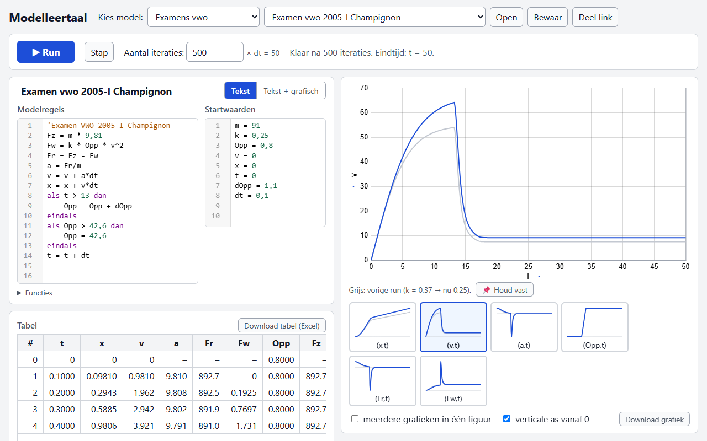
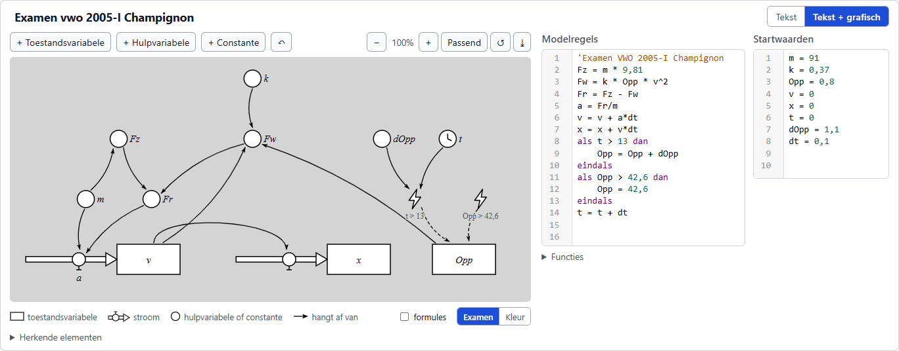
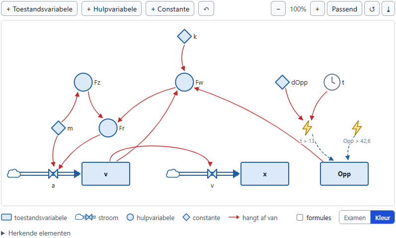
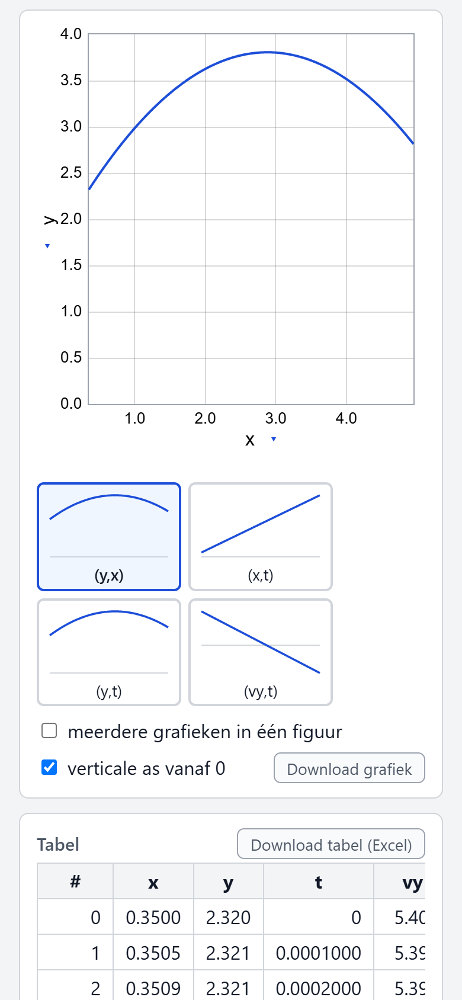

Compiler en webapp voor *Modelleertaal*
=======================================

### [▶ Probeer de webapp!](https://tomkooij.github.io/modelleertaal)

De webapp werkt in je browser (computer, tablet of telefoon). Niets installeren, geen account.

> **Liever de oude indeling? Gebruik [Modelleertaal classic](https://www.tomkooij.nl/modelleertaal-classic).**
>
> Versie 6 van de webapp heeft een nieuwe indeling. Ben je gewend aan de vorige versie (5.4.2), bijvoorbeeld
> omdat je lesmateriaal of instructies daarop gebaseerd zijn, dan kun je die blijven gebruiken op
> [www.tomkooij.nl/modelleertaal-classic](https://www.tomkooij.nl/modelleertaal-classic). Dit is een
> gearchiveerde kopie: die blijft beschikbaar, maar wordt niet meer bijgewerkt.

[](https://github.com/tomkooij/modelleertaal/actions/workflows/test.yml)

*Modelleertaal* is de taal van *natuurkundig modelleren*: de numerieke (dynamische) modellen in de
natuurkunde op de middelbare school en in de centrale examens (vwo). Deze repository bevat een snelle
compiler van *Modelleertaal* naar javascript en een webapp die alle modellen uit de natuurkunde op de
middelbare school kan doorrekenen.

## Webapp

[](https://tomkooij.github.io/modelleertaal)

De webapp is gemaakt voor leerlingen: je moet hem zonder handleiding kunnen gebruiken. De belangrijkste ontwerpeis voor
de UI is: Geen knoppencursus nodig! Deze eis komt voort uit mijn aanleiding om dit ooit te bouwen: Ik snapte zelf niet
hoe je een grafiek kon maken in de software die ik op school gebruikte voor numerieke modellen. Laat staan leerlingen.

Waarom de webapp werkt zoals hij werkt (de didactische uitgangspunten, en per onderdeel de overweging erachter)
staat in **[DIDACTIEK.md](DIDACTIEK.md)**.

- **Rondleiding.** Nieuw hier? De knop **Rondleiding** rechtsboven laat in vijf stappen de belangrijkste
  onderdelen zien. Hij start nooit vanzelf.
- **Model en Run.** Kies een examenmodel of begin met een leeg model. Typ de *modelregels* en
  *startwaarden* en druk op **Run** (of Ctrl+Enter).
- **Automatische grafieken.** Na Run kiest de webapp zelf de grafieken die bij het model passen: (x,t), (v,t),
  (a,t), de baan (y,x), ... Klik op een miniatuur om die groot te zien. Een andere grootheid kies je op de as zelf.
- **Grafieken aflezen.** Klik op een punt in de grafiek: een stip met hulplijnen naar beide assen, zoals je op
  papier afleest, en de rij in de tabel licht op (en andersom: klik op een rij). Bij één grafiek tekent de
  webapp ook de raaklijn, tot aan de assen. Klik op de raaklijn: de snijpunten met de assen worden afgelezen en
  de helling volgt uit de breuk Δy/Δx, ingevuld met die punten (`(1,5 − 0,4127)/(0,4525 − 0) = 2,403 m/s`): zo bepaal je bijvoorbeeld de
  versnelling uit het (v,t)-diagram. Zie [DIDACTIEK.md](DIDACTIEK.md).
- **Eenheden.** Schrijf een eenheid tussen rechte haken in het commentaar achter een startwaarde
  (`v = 0 '[m/s]`) en hij staat op de assen (`v (m/s)`), in de tabel en in de downloads. Eenheden die
  er niet staan worden waar het kan afgeleid uit de formules: met `x '[m]` en `t '[s]` krijgt `v` in
  `x = x + v*dt` de eenheid m/s, en `Fres/m` met `Fres` in N en `m` in kg wordt m/s². In *Tekst + grafisch*
  zet de knop **eenheden** de eenheden achter de namen in het diagram en een veld *Eenheid* in de
  formulieren; de afgeleide eenheid staat daar als grijze hint.
- **Stap voor stap.** Met **Stap** reken je het model regel voor regel door. Onder de runbalk staat de
  berekening met ingevulde getallen (`v = v + a*dt  →  v = 0,981 + 9,78 × 0,1 = 1,959`), de regel licht op
  in de editor en de waarde die net veranderde in de tabel. In de grafiek groeien de punten mee over de
  laatste run. Zo zie je hoe de rekenlus werkt.
- **Runs vergelijken.** De vorige run blijft zichtbaar als grijze lijn. Verander een startwaarde (bijvoorbeeld `k`),
  druk op Run en zie wat er veranderd is; onder de grafiek staat wat er anders is (`k = 0,37 → nu 0,50`).
  Met **Houd vast** blijft een grijze lijn staan als referentie.
- **Foutmeldingen in het Nederlands,** in de pagina, met de regel gemarkeerd in de editor en suggesties bij
  typefouten (*Bedoel je 'Fres'?*). Een waarschuwing als een waarde geen geldig getal meer is (delen door nul,
  *dt* te groot).
- **Hulp bij het modelleren.** Naast het aantal iteraties laat de webapp zien hoe lang het model loopt
  (`× dt = 50 s`). Heeft het model een `stop` die niet bereikt wordt, dan meldt de webapp dat en biedt aan om het
  aantal iteraties te verdubbelen. Na Run rekent de webapp het model ook door met de halve tijdstap; hangt de
  uitkomst daarvan af, dan krijg je de melding dat *dt* te groot is. Een tip wijst veelgemaakte fouten aan,
  zoals een tijd die niet loopt (`t = t + dt` vergeten) of een startwaarde die nergens gebruikt wordt.
- **Tabel** met alle waarden, en downloads: de tabel voor Excel (TSV) en de grafiek als plaatje (PNG).
- **Je werk raakt niet kwijt.** Werk dat niet bewaard is, blijft in de browser staan: bij je volgende bezoek kun
  je verder. **Bewaar** slaat het model op als bestand, **Open** opent het weer.
- **Deel link** kopieert een link met het (aangepaste) model en de titel erin: deel die met een leerling,
  een collega of in je lesmateriaal.
- **Opdracht bij een model** (voor docenten). Schrijf in *Meer opties* een opdracht bij het model; die staat
  boven het model en gaat mee in Deel link en Bewaar. Zo deel je een model met puntjes en een vraag in één link.

### Grafisch model

[](https://tomkooij.github.io/modelleertaal)

Kies **Tekst + grafisch** om het model als stock-flow diagram te zien, getekend zoals de grafische modellen
in de centrale examens (vwo natuurkunde, bijvoorbeeld 2022-I *Vrije worp bij basketbal* en 2023-II *Fietshelm*):
zwart op een grijze achtergrond, *toestandsvariabelen* (rechthoeken), *stromen* (holle pijlen met een ventiel:
een cirkel met een kraantje), *hulpvariabelen* en *constanten* (cirkels, naam eronder) en zwarte pijlen voor
"hangt af van". *Voorvallen* (`als ... dan` waarin een *toestandsvariabele* verandert) worden als bliksem getekend.



Liever in kleur? De schakelaar **Examen | Kleur** onder het diagram tekent hetzelfde model met de symbolen
die je in de meeste software voor System Dynamics tegenkomt: blauwe symbolen en rode pijlen voor "hangt af
van". In deze stijl is een *hulpvariabele* een cirkel, een *constante* een ruit en een *stopvoorwaarde* een
stopbord (achthoek). Een *stroom* is een buis met een ventiel in de vorm van een vlinderdas; een *stroom* van
of naar buiten het model begint of eindigt in een wolkje. De webapp onthoudt je keuze, en **Download** slaat
het diagram op in de stijl die je ziet.

Bronnen van de twee stijlen:

| Stijl | Bron |
|---|---|
| Examen | De grafische modellen in de centrale examens natuurkunde vwo op [examenblad.nl](https://www.examenblad.nl): 2022-I *Vrije worp bij basketbal* (figuur 5), 2023-II *Fietshelm* (figuur 6), 2018-I *Uitrijden van een auto* (figuur 2) |
| Kleur | De gangbare stock-flow notatie (zie de tabel hieronder): J.W. Forrester, *Industrial Dynamics* (1961), hoofdstuk *Symbols for flow diagrams*; J.D. Sterman, *Business Dynamics* (2000); de handleidingen van Stella, Vensim en Powersim; Coach 7 (A. Heck, *Guide on modelling*, UvA, figuur 3.10 *A graphical model in Coach 7*) voor de kleuren, de cirkel en de pijlen |

Waarom deze symbolen in de kleurstijl? De examenstijl volgt het examen; de kleurstijl volgt wat je buiten
school ziet, in boeken over System Dynamics en in de bekende programma's. Zo herkent een leerling of docent
die met andere software werkt het diagram meteen, en wat je hier leert is niet aan één programma gebonden.
Per symbool:

| Element | Symbool in Kleur | Waar het vandaan komt |
|---|---|---|
| *toestandsvariabele* | rechthoek | Forrester (*level*), en alle programma's: Coach, Stella, Vensim, Powersim, Insight Maker |
| *stroom* | dikke buis met een ventiel als vlinderdas | Forrester (*rate*: een kraan in de buis), Sterman, Vensim (*valve*) |
| *stroom* van of naar buiten het model | wolkje | Forrester (*source* en *sink*), Sterman, [Stella](https://iseesystems.com/resources/help/v3/Content/08-Reference/ObjectIconography.htm) en [Vensim](https://vensim.com/documentation/ref_variable_types.html): het wolkje is de grens van het model, wat daar gebeurt rekenen we niet uit |
| *hulpvariabele* | cirkel | Coach 7 (*hulpvariabele*), Stella (*converter*), Powersim (*auxiliary*) |
| *constante* | ruit | Powersim (*constant*), zie de [Powersim Studio best practices](https://powersim.com/wp-content/uploads/2022/06/SANDIAPowersimStudioBestPracticesManual06-23-2011.pdf) (Sandia, 2011) |
| "hangt af van" | dunne, gebogen pijl | Coach 7 (*relatiepijl*, rood), Stella (*connector*), Vensim (*arrow*): informatie, geen materie, en hij wijst nooit naar een *toestandsvariabele* |
| *stopvoorwaarde* | achthoek (stopbord) | eigen keuze: de ruit is in deze stijl al de *constante* |
| *voorval* | bliksem (geel) | het *Event* van [AnyLogic](https://anylogic.help/anylogic/statecharts/events.html): een gele bliksem voor iets wat op één moment gebeurt |
| *onafhankelijke variabele* (`t`) | klok | het blok *Clock* van [Simulink](https://www.mathworks.com/help/simulink/slref/clock.html), dat de simulatietijd geeft |

Bliksem en klok horen niet bij de stock-flow notatie van Forrester en staan ook niet in de examenfiguren;
de webapp tekent ze in beide stijlen (in Examen zwart-wit). Welke elementen er zijn (een *voorval* als
voorwaarde die een *toestandsvariabele* sprongsgewijs verandert, en een *onafhankelijke variabele*) volgt
de handleiding van Coach 7 (hoofdstuk *Modelelementen voor de grafische en vergelijkingenmodus*), net als
de rest van *Modelleertaal*. De pictogrammen zijn daar niet van overgenomen: in die software wordt de
onafhankelijke variabele standaard niet getekend.

Waarom een ruit voor een *constante* en geen cirkel? In de examenstijl zien *hulpvariabele* en *constante* er
hetzelfde uit (zoals in de examens); in de kleurstijl zie je meteen wat elke stap opnieuw uitgerekend wordt
(cirkel) en wat vast ligt (ruit). Vensim tekent beide als alleen een naam, maar voor leerlingen is een
zichtbaar verschil duidelijker.

De kleuren (blauwe symbolen met een lichtblauwe vulling, rode pijlen op wit) sluiten aan bij wat veel
leerlingen al van school kennen: de kleuren van Coach 7. Ze zijn iets zachter gemaakt dan puur blauw en rood, zodat het diagram
rustig blijft, en de rode pijlen vallen op tussen de blauwe symbolen: precies die pijlen ("waar hangt dit
van af?") moet een leerling lezen.

Een vergelijking met de grafische modellen in de
[SLO-voorbeelden van computermodellen](https://www.slo.nl/thema/vakspecifieke-thema/natuur-techniek/modelleren/voorbeelden-computermodellen-natuurkunde/),
en waarom er geen derde stijl is, staat in [DIDACTIEK.md](DIDACTIEK.md#vergelijking-met-de-slo-voorbeelden).

- Het diagram wordt getekend uit de tekst van het model, terwijl je typt. Run is niet nodig.
- **Tekst en diagram zijn gekoppeld.** Klik op een symbool en de regels ervan worden gemarkeerd in de tekst.
  Zet de cursor in een regel van de tekst en het symbool licht op. Na Run zie je de eerste en laatste waarde
  als je met de muis boven een symbool staat.
- **Het diagram is ook invoer.** Klik op een symbool om de naam of formule te veranderen, voeg
  *toestandsvariabelen*, *stromen*, *hulpvariabelen* en *constanten* toe (met de **+** knoppen bij een gekozen
  *toestandsvariabele* voeg je een stroom in of uit toe), of verwijder ze. Elke wijziging is een kleine wijziging
  in de tekst van het model: de tekst blijft het model, net als in de examens. Namen van variabelen voeg je
  in met een klik, dus zonder typefouten.
- Versleep symbolen, zoom in en uit en schuif het diagram. *Herkende elementen* laat zien hoe elke regel van de
  tekst herkend is. Download het diagram als SVG.

<br clear="right">

### Op een telefoon of tablet



De indeling past zich aan het scherm aan. Op een telefoon staan het model, de grafiek en de tabel onder elkaar;
na Run scrolt de pagina naar de grafiek. Het grafische model past in de breedte van het scherm en je zoomt
met twee vingers.

De webapp (HTML/Javascript) werkt in elke moderne browser op Windows, macOS, ChromeOS, Android en iOS. Hij is
ontwikkeld en getest in Chrome. Werkt het niet, of is het niet makkelijk te gebruiken? Laat het weten:
[geef feedback](https://github.com/tomkooij/modelleertaal/issues).

<br clear="right">

## De webapp in je eigen website gebruiken

(graag zelfs!)

Alleen `index.html` en de mappen `scripts/` en `modellen/` zijn nodig om de webapp in een browser of op een
website te draaien. Je hebt wel het gebrowserifyde bestand `scripts/modelleertaal-app.browser.js` nodig, dat
niet in de `master` branch staat. Je kunt het zelf bouwen (zie hieronder) of een zip of tarball downloaden van
de [releasepagina](https://github.com/tomkooij/modelleertaal/releases).

Pas eventueel de modellen in `modellen/` aan en wijzig `modellen/models.js` op dezelfde manier. De modellen
staan in verzamelingen: de examens in `modellen/`, de modules in submappen (`modellen/b1`, `c2`, `c3`). In
`models.js` heeft elk model een `groep` (de eerste keuzelijst: de verzameling) en een `sectie` (een kopje in
de tweede keuzelijst, zoals Basismodellen of Opgaven). `python update_models_js.py` (in de map `modellen`)
zet nieuwe bestanden achteraan in hun groep en haalt verwijderde bestanden weg. Zet het
geheel ergens op een website. Alle code draait in de browser, dus een server is niet nodig.

In `config.js` kun je de webapp aanpassen (knoppen en opties aan- en uitzetten).

## Over *Modelleertaal*

*Modelleertaal* is de taal die gebruikt wordt bij "natuurkundig modelleren"
(dynamische modellen in de natuurkunde op de middelbare school in Nederland. System dynamics, Jay W. Forrester,
DYNAMO, ...). De taal is een deelverzameling van "CoachTaal", een imperatieve taal afgeleid van Pascal.

*Modelleertaal* probeert zo veel mogelijk te lijken op de schrijfwijze in Nederlandse lesmethodes en examens.
Dat is CoachTaal, met een paar verschillen:

 - Opdrachten eindigen niet met ;
 - = is de toekenning (:= mag ook en betekent hetzelfde. Iets anders dan in CoachTaal)
 - == is de operator 'is gelijk aan', in plaats van =. In de praktijk is == nooit nodig.
   Een enkele = wordt direct in een voorwaarde geaccepteerd als 'is gelijk aan': `als x = 3 dan`.
 - Alleen 'als dan eindals', 'anders' en 'stop' zijn geïmplementeerd. Andere opdrachten voor de programmaloop
   worden in *Modelleertaal* nooit gebruikt.
 - Je kunt geen functies definiëren. De meeste wiskundige functies uit CoachTaal zijn geïmplementeerd.
 - sin(x), cos(x) en tan(x) rekenen altijd in graden. De andere goniometrische functies in radialen.
 - Commentaar in de stijl van C/Java mag ook.

Voorbeeld:
```
Als (a == 0) En Niet(b == Waar) Dan Stop       'modelleertaal
```

In Pascal:
```
If (a = 0) AND !(b = True) then Halt(0);
```

Examen vwo 2005-I Champignon:
```
     'model parachutesprong
     'modelregels
     Fwr = k * v^2
     Fres = Fzw - Fwr
     a = Fres/m
     dv = a * dt
     v = v + dv
     dy = v * dt
     y = y + dy
     h = h0 - y
     t = t + dt
     als h < 400 dan k = 0.6 * (400 - h) eindals
     als h < 350 dan k = 30 eindals
```

## Over de compiler

`evaluator.js` bevat een compiler van *Modelleertaal* naar javascript. De parser is gebouwd met
[jison](https://github.com/zaach/jison). Modelleertaal wordt gecompileerd naar
javascript, dat wordt uitgevoerd met `eval()`. (De `eval()` zit in een anonieme functie, zodat de optimaliserende
compiler van V8 niet afhaakt. Dit was relevant in 2015 toen Chrome V8 Crankshaft nog the state-of-the-art was, nu
is dat waarschijnlijk niet meer nodig. Zelfs de meest eenvoudige telefoon is ruim snel genoeg om niet meer te hoeven
nadenken over optimalisaties.)

Gebruik:
```javascript
model = new evaluator_js.Model();
model.modelregels = "a = a + 1";
model.startwaarden ="a = 1\n b=2\n";

N = 1000;
var evaluator = new evaluator_js.ModelregelsEvaluator(model);
results = evaluator.run(N);
```

## Modelsyntax BogusXML

`model.js` leest en schrijft modellen. Een model is een tekstbestand (`.xml`) in *BogusXML*: het lijkt op XML,
maar is het niet. De modelregels staan er letterlijk in, met `<` en `>` (`als h < 0 dan`) en zonder `&lt;`.
Zo kun je een model in Kladblok openen, lezen en aanpassen, precies zoals het in de webapp staat. Een
XML-parser kan het bestand daardoor niet lezen; `model.js` leest het regel voor regel en gebruikt de tags
alleen als scheidingsregels.

```
<modelleertaal>
N = 500
<startwaarden>
m = 91 'kg
dt = 0,1 's
</startwaarden>
<modelregels>
a = Fres/m
v = v + a*dt
</modelregels>
<grafisch>
Fres: Fz, Fw
</grafisch>
</modelleertaal>
```

- `<startwaarden>` en `<modelregels>` bevatten de tekst van het model, letterlijk.
- `N = ...` (buiten de secties) is het aantal iteraties.
- `<grafisch>` (optioneel, sinds 6.3) geeft aanwijzingen voor het grafische model, bijvoorbeeld de pijlen van
  een regel met `...` zoals in de figuur van het examen.
- `<opdracht>` (optioneel) is de opdracht bij het model; `<indeling>` (optioneel) bewaart de posities van
  versleepte symbolen in het grafische model.
- De titel staat niet in het bestand, maar in `modellen/models.js` (of is de bestandsnaam).

De exacte specificatie, met alle regels en eigenaardigheden van de parser, staat in **[BogusXML.md](BogusXML.md)**.
Verander je iets aan het lezen of schrijven van modellen (een nieuwe sectie, een nieuwe instelling, ander gedrag
van `model.js`), werk dan ook [BogusXML.md](BogusXML.md) bij, in dezelfde commit.

## Installatie voor ontwikkeling

Om de `master` branch (de ontwikkelversie) van de webapp en/of de compiler te gebruiken, moet je die eerst
bouwen. Daarvoor heb je Node.js, npm en grunt nodig:

```
npm install -g grunt-cli
npm install
grunt
```

### Screenshots voor de README

De screenshots in `images/` worden gemaakt met [`tools/screenshots.mjs`](tools/screenshots.mjs). Dat script
start een eigen webserver, opent de webapp in Chrome headless en klikt zelf door de webapp (model laden, Run,
startwaarde veranderen, grafisch model). Nodig: Node.js 22 of nieuwer en Google Chrome. Na `grunt build`:

```
npm run screenshots
```

Verandert de webapp zichtbaar, draai het dan opnieuw.

## De webapp offline gebruiken

De webapp zou offline moeten werken, maar de beveiliging van de browser kan het laden van de modellen
tegenhouden (bescherming tegen cross-site scripting kan het ajax-verzoek blokkeren). Op het moment van schrijven
blokkeert de CORS-bescherming de webapp in Chrome, Firefox en Edge. Installeer een browserextensie die de
CORS-bescherming uitzet, of gebruik een lokale webserver (`python -m http.server`).

## Licentie en dank

Deze compiler en webapp implementeren de taal die gebruikt wordt in de natuurkunde-examens van de Nederlandse
middelbare school. Deze taal is (gebaseerd op) Coach en CoachTaal. Coach is ontwikkeld door
[CMA Science](http://cma-science.nl/).

De webapp is gebouwd met jQuery en Flot en sterk geïnspireerd door [HiSPARC jSPARC](http://github.com/HiSPARC/jSPARC/).

Het geheel is oorspronkelijk gebaseerd op Zach Carters [jsconf 2010 jison talk](https://github.com/zaach/zii-jsconf2010-talk).

### MIT-licentie

De licentietekst is de officiële Engelse tekst:

```Copyright (c) 2017 Tom Kooij

Permission is hereby granted, free of charge, to any person obtaining a copy
of this software and associated documentation files (the "Software"), to deal
in the Software without restriction, including without limitation the rights
to use, copy, modify, merge, publish, distribute, sublicense, and/or sell
copies of the Software, and to permit persons to whom the Software is
furnished to do so, subject to the following conditions:

The above copyright notice and this permission notice shall be included in all
copies or substantial portions of the Software.

THE SOFTWARE IS PROVIDED "AS IS", WITHOUT WARRANTY OF ANY KIND, EXPRESS OR
IMPLIED, INCLUDING BUT NOT LIMITED TO THE WARRANTIES OF MERCHANTABILITY,
FITNESS FOR A PARTICULAR PURPOSE AND NONINFRINGEMENT. IN NO EVENT SHALL THE
AUTHORS OR COPYRIGHT HOLDERS BE LIABLE FOR ANY CLAIM, DAMAGES OR OTHER
LIABILITY, WHETHER IN AN ACTION OF CONTRACT, TORT OR OTHERWISE, ARISING FROM,
OUT OF OR IN CONNECTION WITH THE SOFTWARE OR THE USE OR OTHER DEALINGS IN THE
SOFTWARE.
```
