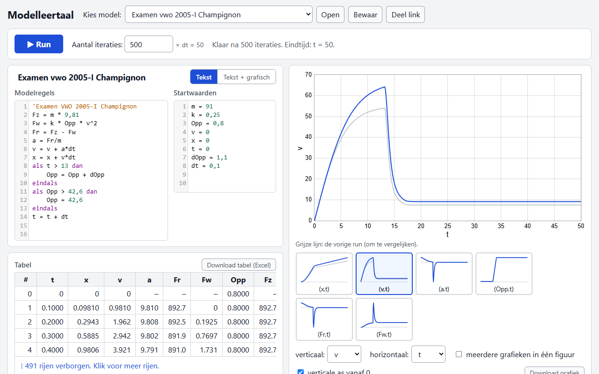
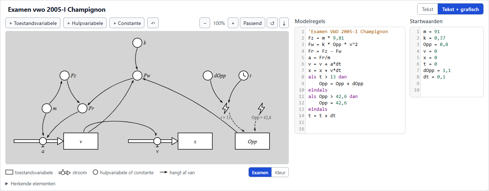
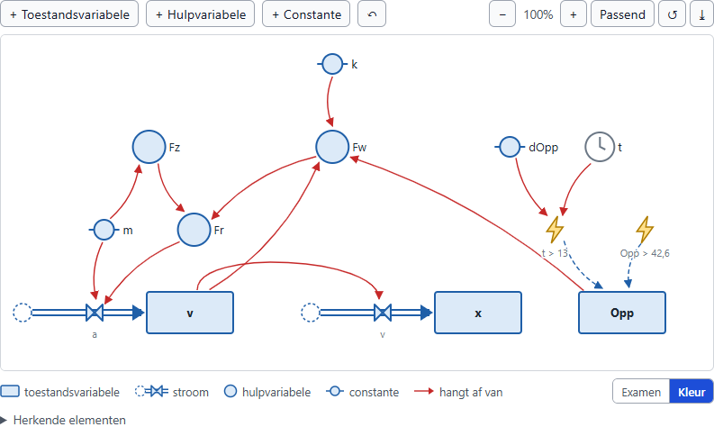
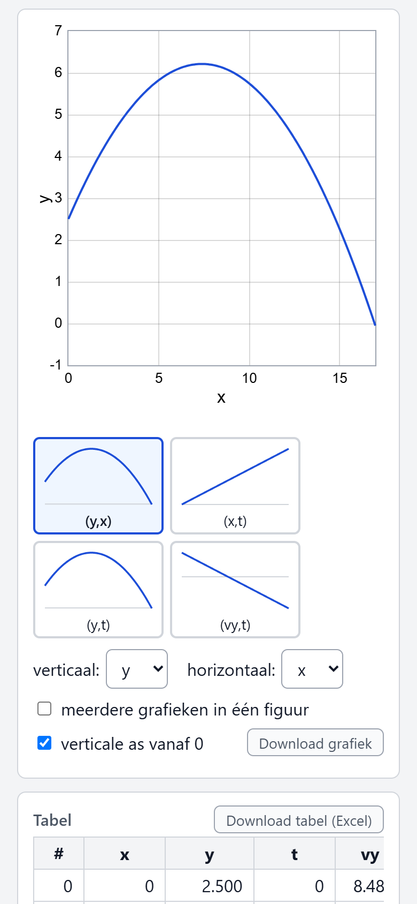

Compiler en webapp voor *Modelleertaal*
=======================================

### [▶ Probeer de webapp!](https://tomkooij.github.io/modelleertaal)

De webapp werkt in je browser (computer, tablet of telefoon). Niets installeren, geen account.

> **Liever de oude indeling? Gebruik [Modelleertaal classic](https://www.tomkooij.nl/modelleertaal-classic).**
>
> Versie 6 van de webapp heeft een nieuwe indeling. Ben je gewend aan de vorige versie (5.4.2), bijvoorbeeld
> omdat je lesmateriaal of instructies daarop gebaseerd zijn, dan kun je die blijven gebruiken op
> [www.tomkooij.nl/modelleertaal-classic](https://www.tomkooij.nl/modelleertaal-classic). Dit is een
> gearchiveerde kopie: die blijft beschikbaar, maar wordt niet meer bijgewerkt.

[](https://github.com/tomkooij/modelleertaal/actions/workflows/test.yml)

*Modelleertaal* is de taal van *natuurkundig modelleren*: de numerieke (dynamische) modellen in de
natuurkunde op de middelbare school en in de centrale examens (vwo). Deze repository bevat een snelle
compiler van *Modelleertaal* naar javascript en een webapp die alle modellen uit de natuurkunde op de
middelbare school kan doorrekenen.

## Webapp

[](https://tomkooij.github.io/modelleertaal)

De webapp is gemaakt voor leerlingen: je moet hem zonder handleiding kunnen gebruiken. De belangrijkste ontwerpeis voor
de UI is: Geen knoppencursus nodig! Deze eis komt voort uit mijn aanleiding om dit ooit te bouwen: Ik snapte zelf niet
hoe je een grafiek kon maken in de software die ik op school gebruikte voor numerieke modellen. Laat staan leerlingen.

- **Model en Run.** Kies een examenmodel of begin met een leeg model. Typ de *modelregels* en
  *startwaarden* en druk op **Run** (of Ctrl+Enter).
- **Automatische grafieken.** Na Run kiest de webapp zelf de grafieken die bij het model passen: (x,t), (v,t),
  (a,t), de baan (y,x), ... Klik op een miniatuur om die groot te zien. Klik op een punt om de waarden af te lezen.
- **Stap voor stap.** Met **Stap** reken je het model regel voor regel door. Onder de runbalk staat de
  berekening met ingevulde getallen (`v = v + a*dt  →  v = 0,981 + 9,78 × 0,1 = 1,959`), de regel licht op
  in de editor en de waarde die net veranderde in de tabel. Zo zie je hoe de rekenlus werkt.
- **Runs vergelijken.** De vorige run blijft zichtbaar als grijze lijn. Verander een startwaarde (bijvoorbeeld `k`),
  druk op Run en zie wat er veranderd is; onder de grafiek staat wat er anders is (`k = 0,37 → nu 0,50`).
  Met **Houd vast** blijft een grijze lijn staan als referentie.
- **Foutmeldingen in het Nederlands,** in de pagina, met de regel gemarkeerd in de editor en suggesties bij
  typefouten (*Bedoel je 'Fres'?*). Een waarschuwing als een waarde geen geldig getal meer is (delen door nul,
  *dt* te groot).
- **Hulp bij het modelleren.** Naast het aantal iteraties laat de webapp zien hoe lang het model loopt
  (`× dt = 50`). Heeft het model een `stop` die niet bereikt wordt, dan meldt de webapp dat en biedt aan om het
  aantal iteraties te verdubbelen. Na Run rekent de webapp het model ook door met de halve tijdstap; hangt de
  uitkomst daarvan af, dan krijg je de melding dat *dt* te groot is.
- **Tabel** met alle waarden, en downloads: de tabel voor Excel (TSV) en de grafiek als plaatje (PNG).
- **Je werk raakt niet kwijt.** Werk dat niet bewaard is, blijft in de browser staan: bij je volgende bezoek kun
  je verder. **Bewaar** slaat het model op als bestand, **Open** opent het weer.
- **Deel link** kopieert een link met het (aangepaste) model en de titel erin: deel die met een leerling,
  een collega of in je lesmateriaal.

### Grafisch model

[](https://tomkooij.github.io/modelleertaal)

Kies **Tekst + grafisch** om het model als stock-flow diagram te zien, getekend zoals de grafische modellen
in de centrale examens (vwo natuurkunde, bijvoorbeeld 2022-I *Vrije worp bij basketbal* en 2023-II *Fietshelm*):
zwart op een grijze achtergrond, *toestandsvariabelen* (rechthoeken), *stromen* (holle pijlen met een ventiel:
een cirkel met een kraantje), *hulpvariabelen* en *constanten* (cirkels, naam eronder) en zwarte pijlen voor
"hangt af van". *Voorvallen* (`als ... dan` waarin een *toestandsvariabele* verandert) worden als bliksem getekend.



Liever in kleur? De schakelaar **Examen | Kleur** onder het diagram tekent hetzelfde model in de kleuren van
Coach 7: blauwe symbolen en rode pijlen voor "hangt af van". In deze stijl zijn *hulpvariabelen* cirkels en
*constanten* kleine cirkels met aan elke kant een streepje, zoals in Coach 7. Een *stroom* van of naar buiten
het model begint of eindigt in een gestippelde cirkel. De webapp onthoudt je keuze, en **Download** slaat het
diagram op in de stijl die je ziet.

Bronnen van de twee stijlen:

| Stijl | Bron |
|---|---|
| Examen | De grafische modellen in de centrale examens natuurkunde vwo op [examenblad.nl](https://www.examenblad.nl): 2022-I *Vrije worp bij basketbal* (figuur 5), 2023-II *Fietshelm* (figuur 6), 2018-I *Uitrijden van een auto* (figuur 2) |
| Kleur | Coach 7 (CMA), zoals beschreven in A. Heck, [*Guide on modelling*](https://staff.fnwi.uva.nl/a.j.p.heck/Guide_on_modelling/Text/grafischmodelleren.html) (UvA), figuur 3.10 *A graphical model in Coach 7*: een *hulpvariabele* is een cirkel ("indicated by a circle"), een *constante* een cirkel met aan elke kant een streepje ("a circle with two extra line segments on each side"). Het examen 2018-I gebruikt hetzelfde symbool voor een *constante*. |

- Het diagram wordt getekend uit de tekst van het model, terwijl je typt. Run is niet nodig.
- **Tekst en diagram zijn gekoppeld.** Klik op een symbool en de regels ervan worden gemarkeerd in de tekst.
  Zet de cursor in een regel van de tekst en het symbool licht op. Na Run zie je de eerste en laatste waarde
  als je met de muis boven een symbool staat.
- **Het diagram is ook invoer.** Klik op een symbool om de naam of formule te veranderen, voeg
  *toestandsvariabelen*, *stromen*, *hulpvariabelen* en *constanten* toe (met de **+** knoppen bij een gekozen
  *toestandsvariabele* voeg je een stroom in of uit toe), of verwijder ze. Elke wijziging is een kleine wijziging
  in de tekst van het model: de tekst blijft het model, net als in de examens. Namen van variabelen voeg je
  in met een klik, dus zonder typefouten.
- Versleep symbolen, zoom in en uit en schuif het diagram. *Herkende elementen* laat zien hoe elke regel van de
  tekst herkend is. Download het diagram als SVG.

<br clear="right">

### Op een telefoon of tablet



De indeling past zich aan het scherm aan. Op een telefoon staan het model, de grafiek en de tabel onder elkaar;
na Run scrolt de pagina naar de grafiek. Het grafische model past in de breedte van het scherm en je zoomt
met twee vingers.

De webapp (HTML/Javascript) werkt in elke moderne browser op Windows, macOS, ChromeOS, Android en iOS. Hij is
ontwikkeld en getest in Chrome. Werkt het niet, of is het niet makkelijk te gebruiken? Laat het weten:
[geef feedback](https://github.com/tomkooij/modelleertaal/issues).

<br clear="right">

## De webapp in je eigen website gebruiken

(graag zelfs!)

Alleen `index.html` en de mappen `scripts/` en `modellen/` zijn nodig om de webapp in een browser of op een
website te draaien. Je hebt wel het gebrowserifyde bestand `scripts/modelleertaal-app.browser.js` nodig, dat
niet in de `master` branch staat. Je kunt het zelf bouwen (zie hieronder) of een zip of tarball downloaden van
de [releasepagina](https://github.com/tomkooij/modelleertaal/releases).

Pas eventueel de modellen in `modellen/` aan en wijzig `modellen/models.js` op dezelfde manier. Zet het
geheel ergens op een website. Alle code draait in de browser, dus een server is niet nodig.

In `config.js` kun je de webapp aanpassen (knoppen en opties aan- en uitzetten).

## Over *Modelleertaal*

*Modelleertaal* is de taal die gebruikt wordt bij "natuurkundig modelleren"
(dynamische modellen in de natuurkunde op de middelbare school in Nederland. System dynamics, Jay W. Forrester,
DYNAMO, ...). De taal is een deelverzameling van "CoachTaal", een imperatieve taal afgeleid van Pascal.

*Modelleertaal* probeert zo veel mogelijk te lijken op de schrijfwijze in Nederlandse lesmethodes en examens.
Dat is CoachTaal, met een paar verschillen:

 - Opdrachten eindigen niet met ;
 - = is de toekenning (:= mag ook en betekent hetzelfde. Iets anders dan in CoachTaal)
 - == is de operator 'is gelijk aan', in plaats van =. In de praktijk is == nooit nodig.
   Een enkele = wordt direct in een voorwaarde geaccepteerd als 'is gelijk aan': `als x = 3 dan`.
 - Alleen 'als dan eindals', 'anders' en 'stop' zijn geïmplementeerd. Andere opdrachten voor de programmaloop
   worden in *Modelleertaal* nooit gebruikt.
 - Je kunt geen functies definiëren. De meeste wiskundige functies uit CoachTaal zijn geïmplementeerd.
 - sin(x), cos(x) en tan(x) rekenen altijd in graden. De andere goniometrische functies in radialen.
 - Commentaar in de stijl van C/Java mag ook.

Voorbeeld:
```
Als (a == 0) En Niet(b == Waar) Dan Stop       'modelleertaal
```

In Pascal:
```
If (a = 0) AND !(b = True) then Halt(0);
```

Examen vwo 2005-I Champignon:
```
     'model parachutesprong
     'modelregels
     Fwr = k * v^2
     Fres = Fzw - Fwr
     a = Fres/m
     dv = a * dt
     v = v + dv
     dy = v * dt
     y = y + dy
     h = h0 - y
     t = t + dt
     als h < 400 dan k = 0.6 * (400 - h) eindals
     als h < 350 dan k = 30 eindals
```

## Over de compiler

`evaluator.js` bevat een compiler van *Modelleertaal* naar javascript.mDe parser is gebouwd met
[jison](https://github.com/zaach/jison). Modelleertaal wordt gecompileerd naar
javascript, dat wordt uitgevoerd met `eval()`. (De `eval()` zit in een anonieme functie, zodat de optimaliserende
compiler van V8 niet afhaakt. Dit was relevant in 2015 toen Chrome V8 Crankshaft nog the state-of-the-art was, nu
is dat waarschijnlijk niet meer nodig. Zelfs de meest eenvoudige telefoon is ruim snel genoeg om niet meer te hoeven
nadenken over optimalisaties.)

Gebruik:
```javascript
model = new evaluator_js.Model();
model.modelregels = "a = a + 1";
model.startwaarden ="a = 1\n b=2\n";

N = 1000;
var evaluator = new evaluator_js.ModelregelsEvaluator(model);
results = evaluator.run(N);
```

## Modelsyntax BogusXML

`model.js` leest en schrijft modellen. Modellen worden opgeslagen in `BogusXML`: een syntax die op XML lijkt,
maar waarin `<` en `>` mogen voorkomen.

Opdracht voor Claude: Beschrijf BogusXML hier en zet alle features erin als je ze bouwt.

## Installatie voor ontwikkeling

Om de `master` branch (de ontwikkelversie) van de webapp en/of de compiler te gebruiken, moet je die eerst
bouwen. Daarvoor heb je Node.js, npm en grunt nodig:

```
npm install -g grunt-cli
npm install
grunt
```

## De webapp offline gebruiken

De webapp zou offline moeten werken, maar de beveiliging van de browser kan het laden van de modellen
tegenhouden (bescherming tegen cross-site scripting kan het ajax-verzoek blokkeren). Op het moment van schrijven
blokkeert de CORS-bescherming de webapp in Chrome, Firefox en Edge. Installeer een browserextensie die de
CORS-bescherming uitzet, of gebruik een lokale webserver (`python -m http.server`).

## Licentie en dank

Deze compiler en webapp implementeren de taal die gebruikt wordt in de natuurkunde-examens van de Nederlandse
middelbare school. Deze taal is (gebaseerd op) Coach en CoachTaal. Coach is ontwikkeld door
[CMA Science](http://cma-science.nl/).

De webapp is gebouwd met jQuery en Flot en sterk geïnspireerd door [HiSPARC jSPARC](http://github.com/HiSPARC/jSPARC/).

Het geheel is oorspronkelijk gebaseerd op Zach Carters [jsconf 2010 jison talk](https://github.com/zaach/zii-jsconf2010-talk).

### MIT-licentie

De licentietekst is de officiële Engelse tekst:

```Copyright (c) 2017 Tom Kooij

Permission is hereby granted, free of charge, to any person obtaining a copy
of this software and associated documentation files (the "Software"), to deal
in the Software without restriction, including without limitation the rights
to use, copy, modify, merge, publish, distribute, sublicense, and/or sell
copies of the Software, and to permit persons to whom the Software is
furnished to do so, subject to the following conditions:

The above copyright notice and this permission notice shall be included in all
copies or substantial portions of the Software.

THE SOFTWARE IS PROVIDED "AS IS", WITHOUT WARRANTY OF ANY KIND, EXPRESS OR
IMPLIED, INCLUDING BUT NOT LIMITED TO THE WARRANTIES OF MERCHANTABILITY,
FITNESS FOR A PARTICULAR PURPOSE AND NONINFRINGEMENT. IN NO EVENT SHALL THE
AUTHORS OR COPYRIGHT HOLDERS BE LIABLE FOR ANY CLAIM, DAMAGES OR OTHER
LIABILITY, WHETHER IN AN ACTION OF CONTRACT, TORT OR OTHERWISE, ARISING FROM,
OUT OF OR IN CONNECTION WITH THE SOFTWARE OR THE USE OR OTHER DEALINGS IN THE
SOFTWARE.
```
